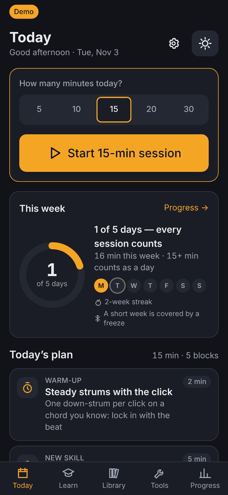

# Self-Guitar

**Try it:** https://mmerah.github.io/self-guitar/

A self-hosted, mobile-first web app (PWA) for learning **acoustic guitar** from beginner to
expert: a structured curriculum, daily 10–20 minute guided practice sessions, and a
Songsterr-style interactive tab player for public-domain repertoire.



> **M6 (part 1)**: fretboard explorer, ear trainer, the L4–L9 skill tree and lesson widgets.
> Next: the L4–L9 lessons. See [VISION.md](VISION.md).

## Features

- **Today**: one tap starts a planned session (warm-up → new skill → technique → review → song);
  only active time counts, a pedal (PageDown / →) runs it hands-free; spaced review, a weekly
  goal with freezes, and an "Am I improving?" progress page.
- **Learn**: skill tree of Levels 0–9 (lessons for 0–3 so far), soft-gated by mastery checks.
- **Play**: scrolling tab with cursor, tempo, A–B loop, count-in, mixer; chord sheets with
  synced lyrics, chord diagrams, strum and transpose; warm-up routines.
- **Tools**: tuner, metronome, chords, 1-minute changes, fretboard explorer + quiz, adaptive ear trainer.
- Works offline (session results queue and sync); all audio processing stays on the device.

**License**: code MIT ([LICENSE](LICENSE)); lessons and exercises CC BY-SA 4.0, song arrangements
CC0, compositions public domain ([content/LICENSE](content/LICENSE)); bundled software and assets
with their license texts: [THIRD_PARTY_NOTICES.md](THIRD_PARTY_NOTICES.md).

## Quick start

```sh
docker compose up -d --build   # http://localhost:3000, data in the self-guitar-data volume
```

No built-in auth: put it behind your reverse proxy or Tailscale. The container runs as uid 1000
(`chown 1000 ./data` for a bind mount).

## Development (Node 22)

```sh
npm install && npm run dev            # :5173
npm test               # content:check + Vitest;  test:e2e / test:e2e:demo = build + Playwright
npm run build && node build                  # production server on :3000 (PORT, DATA_DIR=./data)
npm run build:demo && npm run preview:demo   # static demo on :4321/self-guitar/
```

## Contributing

Issues and PRs welcome. Run `npm run lint && npm run check && npm test`. Content must be
redistributable (see content/LICENSE and content/README.md).
